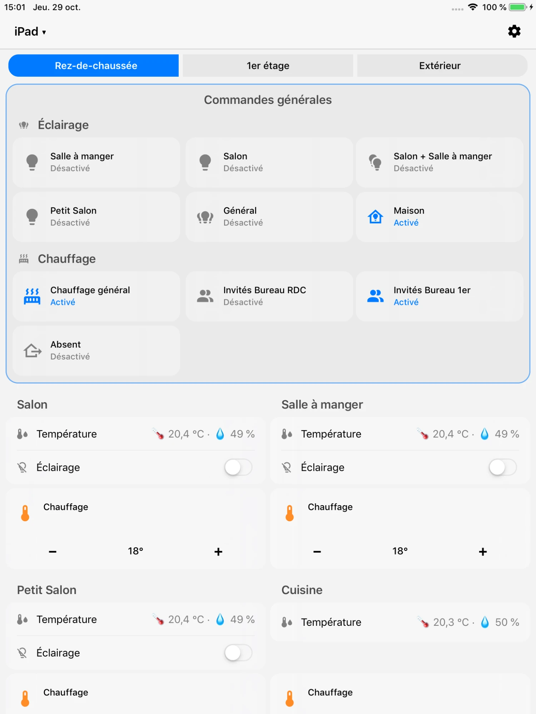
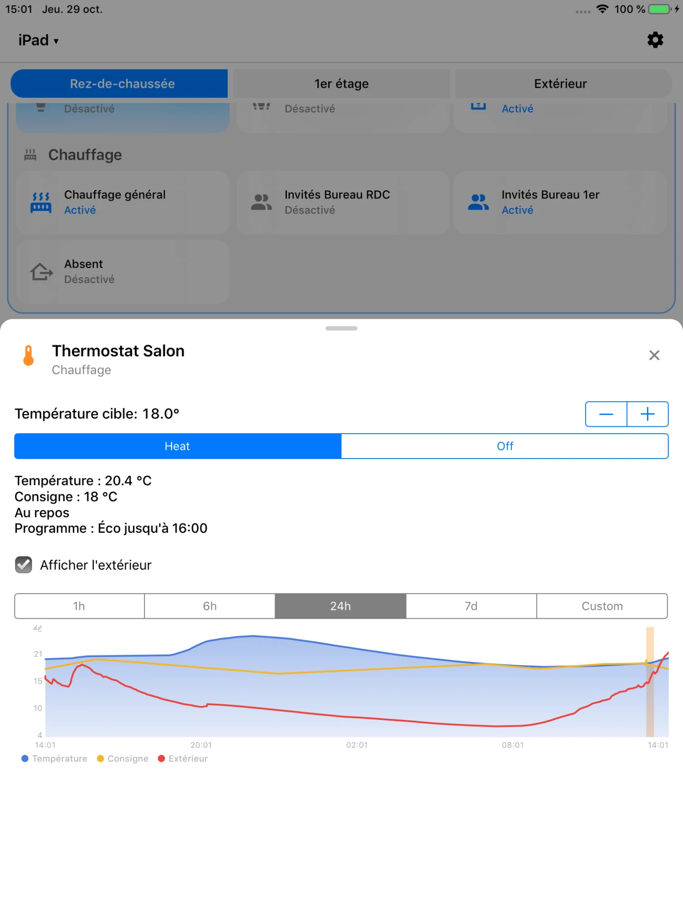
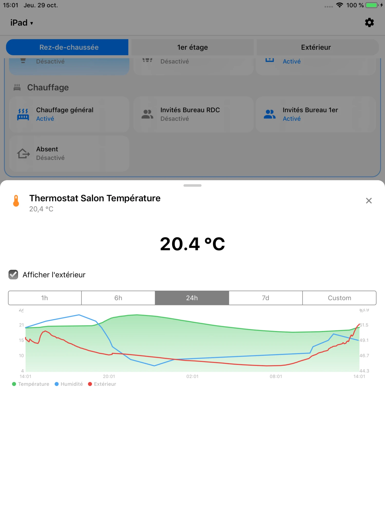
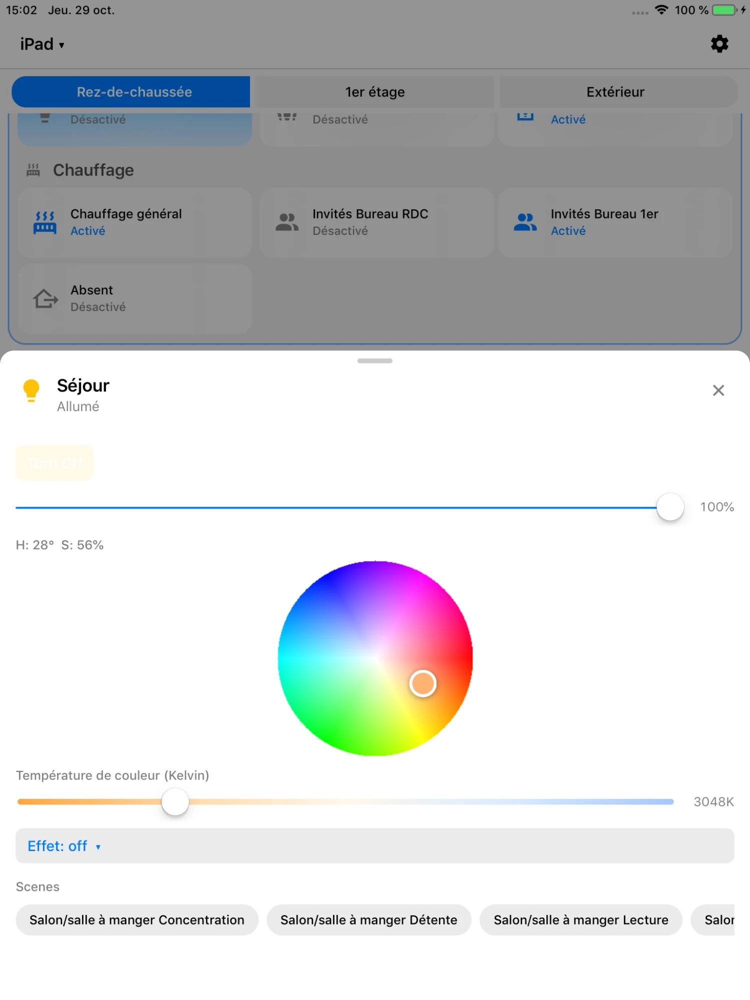

> ## 🇫🇷 À propos de ce fork
>
> **HA Dashboard** est une application iOS native qui affiche vos tableaux de bord
> [Home Assistant](https://www.home-assistant.io/) de façon fluide, même sur de très vieux iPad
> (iPad 2, iPad Air 1, iPad mini…).
>
> **Ce n'est pas mon application.** L'auteur d'origine est **Ash Hopkins**, avec les contributions de
> Sinan Yasar, Matthew Robertson et sharpyexe. Projet d'origine :
> **[ha-dashboard/ios-app](https://github.com/ha-dashboard/ios-app)**. Tout le mérite leur revient.
> Ce fork ajoute seulement quelques modifications pour mon usage (iPad Air 1 sous iOS 12, en mural),
> publiées sous la même licence [Apache 2.0](LICENSE).
>
> ### Aperçu (iPad Air 1, iOS 12)
>
> <table><tr>
> <td width="25%"><br><sub>Commandes générales encadrées, pièces alignées</sub></td>
> <td width="25%"><br><sub>Thermostat : résumé, planning, chauffe surlignée</sub></td>
> <td width="25%"><br><sub>Température, humidité et extérieur</sub></td>
> <td width="25%"><br><sub>Fiche lumière épurée</sub></td>
> </tr></table>
>
> ### Ce que ce fork ajoute
>
> **Mise en page**
> - **Onglets en « pilules »** arrondis, l'onglet actif en couleur d'accent.
> - **Sections pleine largeur** : une section avec `column_span: 2` (ou plus) occupe toute la largeur,
>   titre centré et **cadre arrondi** pour la mettre en avant (ex. « Commandes générales » en haut de page).
> - **Sous-titres dans une section** : une carte `heading` placée dans une section devient un sous-titre
>   pleine largeur (ex. « Éclairage » et « Chauffage » dans un même bloc).
> - **Pièces alignées** : quand deux sections sont côte à côte, la dernière tuile de la plus courte
>   descend pour s'aligner sur l'autre ; les blocs ont la même hauteur même si une pièce a une ligne de moins.
>
> **Chauffage (entités `climate`)**
> - **Appui court** : fiche avec un résumé (température, consigne, chauffe en cours, prochain changement
>   du planning `schedule.*`) et un graphique température + consigne où les **périodes de chauffe sont surlignées**.
> - **Appui long** : temps de chauffe **du jour, de la semaine et du mois** (calculé depuis l'historique HA).
> - **Boutons − / + plus grands** sur les tuiles thermostat ; un appui à côté n'ouvre plus la fiche par erreur.
>
> **Température et humidité**
> - Fiche d'un capteur de température ou d'humidité : graphique **température (vert)** + **humidité (bleu)**
>   sur 1 h, 6 h, 24 h ou 7 jours.
> - Case **« Afficher l'extérieur »** : ajoute la température extérieure en **rouge** (capteur extérieur
>   détecté automatiquement, sinon l'entité `weather`). Le choix est mémorisé.
> - Poser le doigt sur un graphique et le faire glisser affiche la valeur à l'heure précise.
>
> **Lumières et actions**
> - **Fiches lumière épurées** : on garde l'essentiel (allumage, luminosité, couleur), sans « Flash »,
>   « Transition », historique ni liste technique des attributs.
> - **`tap_action` / `hold_action` respectés** sur les lignes de liste (`entities`) et les tuiles, y compris
>   `more-info` vers une autre entité (`entity: ...`). Utile pour ouvrir le menu d'une vraie lampe par un
>   appui long sur un raccourci.
>
> **Divers** : thème sombre plus lisible ; le graphique ne disparaît plus après plusieurs appuis.
>
> ### En pratique, dans votre tableau de bord HA
>
> Rien à installer côté Home Assistant : l'app lit vos tableaux de bord habituels (vue de type
> **sections**, `max_columns: 2` conseillé sur iPad). Exemple de bloc de commandes en haut de page :
>
> ```yaml
> - type: grid
>   column_span: 2              # pleine largeur + cadre
>   cards:
>     - type: heading
>       heading: Commandes générales   # 1er heading = titre de la section
>     - type: heading
>       heading: Éclairage      # sous-titre
>     - type: tile
>       entity: switch.salon
>       hold_action:            # appui long = menu de la vraie lampe
>         action: more-info
>         entity: light.salon
>     - type: heading
>       heading: Chauffage
>     - type: tile
>       entity: climate.salon
>       features:
>         - type: target-temperature   # boutons − / +
> ```
>
> Pour une pièce, une liste `entities` (température, éclairage) suivie d'une tuile `climate` suffit :
> l'appui sur la température ouvre le graphique, l'appui sur le thermostat ouvre le résumé du chauffage.
> Après une modification dans HA : réglages de l'app → **Clear Cache & Reload**.
>
> ### Installation (tous les iOS, de 9.3.3 à aujourd'hui)
>
> L'IPA publiée ici est **universelle** (armv7 + arm64, iOS 9 minimum) : la même fonctionne sur les
> vieux iPad comme sur les récents. Téléchargez `HADashboard-ipad.ipa` dans la dernière version de la page
> **[Releases](https://github.com/chidori777/ios-app/releases)**. Elle n'est pas signée : il faut la signer
> à l'installation.
>
> | Votre appareil | Méthode |
> |---|---|
> | Non jailbreaké, n'importe quel iOS | [Sideloadly](https://sideloadly.io/) (Windows / macOS) + votre identifiant Apple. Avec un compte Apple **gratuit**, l'app doit être réinstallée **tous les 7 jours** (1 an avec un compte développeur payant). |
> | iOS 14.0 à 16.6.1 ou 17.0 | [TrollStore](https://github.com/opa334/TrollStore) : installation permanente, sans renouvellement. |
> | Jailbreaké (ex. iOS 12 avec checkra1n / unc0ver) | [AppSync Unified](https://github.com/akemin-dayo/AppSync) puis installez l'IPA (Filza, ou Sideloadly) : installation permanente. |
> | iOS 15 ou plus, sans les modifications de ce fork | La version officielle de l'auteur sur l'[App Store](https://apps.apple.com/gb/app/ha-dash/id6759347912). |
>
> Ensuite, dans l'app : saisissez l'adresse de votre Home Assistant, connectez-vous, puis choisissez le
> tableau de bord à afficher (roue dentée → réglages). Le **mode kiosque** masque la barre du haut
> (trois appuis en haut de l'écran pour la réafficher).
>
> L'IPA ne contient aucune donnée personnelle : votre adresse et vos identifiants Home Assistant restent
> uniquement sur votre appareil.
>
> ---
>
> ## 🇬🇧 About this fork
>
> **This is not my app.** HA Dashboard was created by **Ash Hopkins** (with contributions from Sinan Yasar,
> Matthew Robertson and sharpyexe): **[ha-dashboard/ios-app](https://github.com/ha-dashboard/ios-app)**.
> This fork only adds a few changes for my own wall-mounted iPad Air 1, released under the same Apache 2.0
> license: pill-style view tabs; full-width framed sections (`column_span`) with `heading` sub-titles;
> side-by-side sections bottom-aligned to equal height; thermostat sheet with summary, schedule and
> highlighted heating periods, long press for today/week/month heating time, larger − / + buttons;
> temperature (green) + humidity (blue) graphs with an optional outdoor curve (red); simplified light
> sheets; `tap_action` / `hold_action` honoured on entities rows and tiles; a more readable dark theme.
>
> The IPA in **[Releases](https://github.com/chidori777/ios-app/releases)** is universal (armv7 + arm64,
> iOS 9.3.3 and later) and unsigned: install it with Sideloadly (free Apple ID: re-sign every 7 days),
> TrollStore (iOS 14.0–16.6.1 / 17.0), or AppSync Unified on a jailbroken device. On iOS 15+, the original
> author's App Store version is also available (without this fork's changes).
>
> *The original README follows below.*

---

# HA Dashboard

[](https://apps.apple.com/gb/app/ha-dash/id6759347912)

A native iOS app that renders your [Home Assistant](https://www.home-assistant.io/) dashboards natively, achieving usable framerates on the oldest iOS devices.

The universal developer and Ad Hoc build runs on armv7 and arm64 devices from
iOS 9.3.3 through current iOS 27 devices, with a Mac Catalyst developer build.
Starting with 1.2.6, Apple's distribution requirements mean the App Store uses
a separate arm64 build targeting iOS 15 or later; iOS 9–14 devices remain on
the last compatible App Store version or can use the universal developer build
(see [Older devices](#older-devices-ios-933--14x)).
The optional Local Camera Stream requires iOS 10.3.3 or later.

## Features

- **Native rendering** of Home Assistant dashboards — sections, masonry, panel, and sidebar layouts (entities, lights, climate, sensors, cameras, graphs, gauges, badges, and more)
- **Real-time updates** via WebSocket — entity states update live
- **Broad Home Assistant dashboard support** — covers controls, inputs, composite cards, and entity detail views
- **Themes** — Auto, Dark, Light, and Gradient modes with 5 gradient presets plus custom hex colors
- **Kiosk mode** — hides navigation, prevents sleep, triple-tap to escape
- **Dashboard switcher** — switch between multiple HA dashboards
- **Local remote controls** — use Home Assistant's WebSocket notification
  channel to wake/dim an open kiosk, set brightness, navigate, change
  appearance/kiosk state, reload, or show an in-app banner
- **mDNS discovery** — finds Home Assistant servers on your local network
- **Triple auth** — trusted network support, long-lived access token, or full OAuth login flow with token refresh
- **Universal developer build** — armv7 + arm64 in one build, with an iOS 9.0 minimum encoded in both slices
- **Demo mode** — Built-in dashboards with simulated entities and history
- **Optional local camera streams** — Foreground-only, per-device password-protected H.264/AAC RTSP with front/rear selection, simultaneous MultiCam where supported, concurrent consumers, live capability-based quality/orientation, and Home Assistant Generic Camera registration (iOS 10.3.3+)

Local Camera Stream requires RTSP Digest authentication with the fixed username
`hadashboard` and a strong password generated separately on each device. Capture
starts only for an authenticated viewer. RTSP media is still plaintext and is
not encrypted on the LAN, so use it only on a trusted local network and do not
forward ports 8554 or 8555. See the
[streaming contract](docs/live-camera-streaming-v1.md).

Remote commands work only while HA Dashboard is open and connected; they cannot
unlock the device, launch a backgrounded app, or remotely enable camera capture.
See the [support guide](https://ha-dashboard.github.io/ios-app/support.html) for
the supported commands and payloads.

## Screenshots

See the [landing page](https://ha-dashboard.github.io/ios-app/) for screenshots.
*(Ces captures montrent l'app d'origine ; celles de ce fork sont en haut de page.)*

## Requirements

- **Xcode 26 or 27** (modern compiler, devices, simulators, and Catalyst)
- **Xcode 13.2.1 iPhoneOS SDK stubs** (full app or extracted SDK via `XCODE13_SDK_PATH`) for universal iOS 9 device linking
- **XcodeGen** (`brew install xcodegen`)
- A Home Assistant server with pre-configured dashboards

## Getting Started

### Easy path (iOS 15 and later)

Install from the [App Store](https://apps.apple.com/gb/app/ha-dash/id6759347912).
Since 1.2.6, Apple no longer accepts App Store builds that support iOS versions
this old, so the App Store version requires iOS 15 or later.

### Older devices (iOS 9.3.3 – 14.x)

These devices **cannot get new App Store updates**. The App Store offers them
the last compatible version, 1.2.5. Later fixes and features are only available
from the universal IPA attached to each
[GitHub release](https://github.com/ha-dashboard/ios-app/releases). Direct link
to the latest one, which also works in older Safari:
[HADashboard-universal.ipa](https://github.com/ha-dashboard/ios-app/releases/latest/download/HADashboard-universal.ipa)

- **Jailbroken devices:** install the IPA with AppSync Unified or a similar tool.
- **Not jailbroken:** sideload the IPA with a tool such as
  [Sideloadly](https://sideloadly.io) and your Apple ID. With a free Apple ID
  the app must be re-signed every 7 days.

When you report a bug, include your device, iOS version and app version
(Settings → version).

### For contributors or developers

1. **Clone the repo**
   ```bash
   git clone https://github.com/ha-dashboard/ios-app.git
   cd ios-app
   ```

2. **Set up environment**
   ```bash
   cp .env.example .env
   # Edit .env with your Apple Team ID, Bundle ID, and HA credentials
   ```

3. **Generate the Xcode project**
   ```bash
   scripts/regen.sh
   ```

4. **Build and run in the simulator**
   ```bash
   scripts/deploy.sh sim
   ```

## Deploy to Devices

You should customise this to your needs.

```bash
scripts/deploy.sh sim              # iPad simulator
scripts/deploy.sh iphone           # Paired iPhone
scripts/deploy.sh mini5            # iPad Mini 5 (CoreDevice or MobileDevice Wi-Fi)
scripts/deploy.sh mini4            # iPad Mini 4 (MobileDevice Wi-Fi)
scripts/deploy.sh ipad4            # Jailbroken iPad 4 over SSH
scripts/deploy.sh mac              # Local Mac Catalyst build
scripts/deploy.sh all --kiosk      # All targets in kiosk mode
```

See `.env.example` for the device UDIDs and credentials needed for each target.

## Architecture

- Pure **Objective-C**
- Programmatic application UI and Auto Layout (`NSLayoutConstraint` anchors, iOS 9+); `LaunchScreen.storyboard` is the sole storyboard
- **SocketRocket** for WebSocket, **NSURLSession** for REST
- Custom 12-column `UICollectionViewLayout` for iPad multi-column dashboards
- Performance optimizations for older devices: deferred loading, coalesced reloads, cell rasterization, lightweight graph mode

## Testing

```bash
# Run snapshot regression tests
scripts/test-snapshots.sh

# Visual parity screenshots (uses demo.ha-dash.app)
cd scripts && npm install   # One-time: install deps
npm run capture             # Capture HA web screenshots for comparison
```

## FAQs

- I've switched to Kiosk mode, how do I get back to the settings? Triple tap the top of the screen, the menu bar will reappear for a few seconds.

## Links

- [App Store](https://apps.apple.com/gb/app/ha-dash/id6759347912)
- [Landing Page](https://ha-dashboard.github.io/ios-app/)
- [Support](https://ha-dashboard.github.io/ios-app/support.html)
- [Privacy Policy](https://ha-dashboard.github.io/ios-app/privacy.html)

## Privacy

HA Dashboard sends no personal data to the developer. Optional device diagnostics go only to the Home Assistant infrastructure you configure; camera/microphone media goes directly to authenticated RTSP clients while the app is foregrounded and never through a developer relay. See [PRIVACY.md](PRIVACY.md), the [live-streaming contract](docs/live-camera-streaming-v1.md), and the [1.2.6 release dossier](docs/releases/v1.2.6.md).

## License

Licensed under the [Apache License, Version 2.0](LICENSE).
